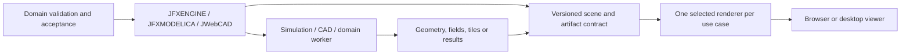

# Proposal: Web Graphics and 3D Projects in the sdk2035 Portfolio

**Review date:** October 15, 2026  
**Input:** `https github com sdk2035.txt` (69 GitHub repository links and two unlinked technology references)  
**Status:** portfolio proposal; the `webfx` fork has been transferred from `sdk2035` to [Open Graphics Initiative](https://github.com/open-graphics-initiative). No dependency adoption or cross-repository implementation is implied.

## 1. Recommendation

Treat this inventory as a set of options for browser delivery, 3D visualization, simulation presentation, CAD interaction and immersive demonstrations. Do not combine the listed engines into one runtime. Select a single renderer for each bounded use case and keep domain calculations, simulation state and acceptance checks in their owning projects.

The most coherent portfolio destinations are:

| Host | Proposed responsibility |
| --- | --- |
| [JFXENGINE](https://github.com/sdk2035/jfxengine) | Reusable engineering visualization experiments, scene/artifact viewing and adapters to selected rendering engines. |
| [JFXMODELICA](https://github.com/sdk2035/jfxmodelica) | Display simulation outputs and digital-twin state through versioned result/artifact contracts. |
| [JWebCAD](https://github.com/sdk2035/JWebCAD) | Browser CAD interaction and geometry preview; keep engineering validation separate from rendering. |
| [JDot](https://github.com/sdk2035/JDot) | Small educational 3D/animation examples with a deliberately limited browser stack. |
| [JFXLCDP](https://github.com/sdk2035/jfxlcdp) | JavaFX-oriented interface authoring and browser delivery experiments, subject to a technical compatibility spike. |

These assignments are inferred from the portfolio profile and repository names. They are proposals, not evidence that these hosts currently integrate with any listed project.

## 2. Catalog and Proposed Fit

The grouping below classifies the 69 supplied `sdk2035` URLs by their apparent primary role. A row's host and priority are recommendations. Fork provenance, current maintenance, licenses, technical compatibility and actual feature coverage were not audited for every repository; verify these before selecting a component.

Priority: **P1** = candidate for a bounded portfolio prototype; **P2** = evaluate only when a use case requires it; **R** = reference, learning material, demo, ecosystem or supporting tool. Priorities do not mean approval or dependency selection.

### Java-to-browser, language tooling and runtimes

| Repository | Proposed category and fit | Host / priority |
| --- | --- | --- |
| [webfx](https://github.com/open-graphics-initiative/webfx) | JavaFX application transpilation/browser delivery candidate; the fork of [webfx-project/webfx](https://github.com/webfx-project/webfx) is now hosted by Open Graphics Initiative. This remains a browser-delivery candidate, not an adopted dependency. | JFXLCDP / P2 |
| [promise](https://github.com/sdk2035/promise) | Asynchronous programming utility/reference; confirm language, API and relation to a concrete host before adoption. | JFXENGINE / R |
| [B4J](https://github.com/sdk2035/B4J) | BASIC development environment/reference; potentially useful for education or legacy-language comparisons. | JDot / R |
| [teavm](https://github.com/sdk2035/teavm) | JVM bytecode to browser/native compilation candidate. | JFXLCDP / P2 |
| [j2cl](https://github.com/sdk2035/j2cl) | Java-to-JavaScript compilation and browser application toolchain candidate. | JFXLCDP / P2 |
| [closure-compiler](https://github.com/sdk2035/closure-compiler) | JavaScript optimization/compiler tooling for a selected browser bundle. | JFXLCDP / R |
| [jsweet](https://github.com/sdk2035/jsweet) | Java-to-TypeScript/JavaScript tooling candidate; compare interoperability and generated-code workflow with other choices. | JFXLCDP / P2 |
| [JWebAssembly](https://github.com/sdk2035/JWebAssembly) | Java bytecode to WebAssembly toolchain candidate; evaluate browser compatibility and host API needs. | JFXLCDP / P2 |
| [cheerpj-meta](https://github.com/sdk2035/cheerpj-meta) | CheerpJ ecosystem/reference metadata; clarify the repository's precise role before treating it as an installable runtime. | JFXLCDP / R |

**Recommendation:** choose at most one Java-to-browser/Wasm route for an initial spike. Compare a minimal JFX screen, a representative dependency, output size, browser APIs, debugging, licensing and reproducible builds. GraalWasm is mentioned in the source without a repository URL; treat it as an evaluation reference, not as a confirmed `sdk2035` repository or a substitute for a Java transpiler.

### Desktop graphics and native bindings

| Repository | Proposed category and fit | Host / priority |
| --- | --- | --- |
| [lwjgl3](https://github.com/sdk2035/lwjgl3) | Java bindings for native graphics and media libraries; desktop rendering or compute experiments, with native packaging constraints. | JFXENGINE / P2 |

### 3D engines and scene frameworks

| Repository | Proposed category and fit | Host / priority |
| --- | --- | --- |
| [Blend4Web](https://github.com/sdk2035/Blend4Web) | Blender-to-web 3D pipeline/framework reference; check maintenance and browser support. | JFXENGINE / R |
| [awayjs-full](https://github.com/sdk2035/awayjs-full) | TypeScript/JavaScript 3D engine candidate. | JFXENGINE / P2 |
| [claygl](https://github.com/sdk2035/claygl) | WebGL 3D/visualization framework candidate. | JFXENGINE / P2 |
| [Babylon.js](https://github.com/sdk2035/Babylon.js) | Full-featured browser 3D engine candidate for interactive engineering scenes. | JFXENGINE / P1 |
| [three.js](https://github.com/sdk2035/three.js) | Browser 3D rendering library and ecosystem candidate for artifact visualization. | JFXENGINE / P1 |
| [playcanvas-engine](https://github.com/sdk2035/playcanvas-engine) | Browser game/3D engine candidate; evaluate editor/tooling needs as well as runtime. | JFXENGINE / P2 |
| [turbulenz_engine](https://github.com/sdk2035/turbulenz_engine) | Browser game engine/reference; verify project activity and compatibility before considering use. | JDot / R |
| [Hilo3d](https://github.com/sdk2035/Hilo3d) | Web 3D engine candidate. | JFXENGINE / P2 |
| [litescene.js](https://github.com/sdk2035/litescene.js) | WebGL scene engine/editor ecosystem candidate. | JFXENGINE / P2 |
| [KickJS](https://github.com/sdk2035/KickJS) | WebGL game-engine reference; verify maintenance before adoption. | JDot / R |
| [Alfrid](https://github.com/sdk2035/Alfrid) | WebGL creative-coding/3D framework candidate. | JDot / P2 |
| [zen-3d](https://github.com/sdk2035/zen-3d) | WebGL 3D engine candidate. | JFXENGINE / P2 |
| [helixjs](https://github.com/sdk2035/helixjs) | WebGL rendering engine candidate. | JFXENGINE / P2 |
| [GrimoireJS](https://github.com/sdk2035/GrimoireJS) | WebGL framework/reference with declarative scene authoring. | JFXENGINE / R |
| [CraZyPG](https://github.com/sdk2035/CraZyPG) | Graphics/3D project; inspect README and scope before assigning a runtime role. | JFXENGINE / R |
| [GLBoost](https://github.com/sdk2035/GLBoost) | WebGL rendering framework candidate. | JFXENGINE / P2 |
| [redcube](https://github.com/sdk2035/redcube) | WebGL/3D engine candidate; confirm project scope and status. | JFXENGINE / R |
| [RedGL2](https://github.com/sdk2035/RedGL2) | WebGL 3D engine candidate. | JFXENGINE / P2 |
| [whs.js](https://github.com/sdk2035/whs.js) | Web 3D framework/abstraction candidate; compare its scene and physics integrations. | JFXENGINE / P2 |
| [osgjs](https://github.com/sdk2035/osgjs) | JavaScript scene graph/rendering framework candidate. | JFXENGINE / P2 |
| [gl-engine](https://github.com/sdk2035/gl-engine) | Graphics engine; scope and maintenance need repository-level confirmation. | JFXENGINE / R |
| [glam](https://github.com/sdk2035/glam) | Graphics/math library or engine reference; inspect actual repository contents before adoption. | JFXENGINE / R |
| [xeogl](https://github.com/sdk2035/xeogl) | Web 3D visualization framework candidate, particularly for model/scene viewing. | JFXENGINE / P2 |
| [four](https://github.com/sdk2035/four) | 3D graphics project; inspect repository contents to establish whether it is an engine, library or demo. | JFXENGINE / R |
| [medium](https://github.com/sdk2035/medium) | 3D/WebGL project; name alone is ambiguous, so confirm its function before assigning it. | JFXENGINE / R |

### 2D, creative coding and interactive learning

| Repository | Proposed category and fit | Host / priority |
| --- | --- | --- |
| [pixijs](https://github.com/sdk2035/pixijs) | 2D WebGL/WebGPU rendering candidate for dashboards, overlays and educational scenes. | JDot / P2 |
| [phaser](https://github.com/sdk2035/phaser) | Browser game framework candidate for interactive learning prototypes. | JDot / P2 |
| [p5.js](https://github.com/sdk2035/p5.js) | Creative-coding/education library for small visualization examples. | JDot / P2 |
| [webgl-workshop](https://github.com/sdk2035/webgl-workshop) | Learning material for graphics fundamentals, not a production runtime dependency. | JDot / R |
| [shader-school](https://github.com/sdk2035/shader-school) | Shader learning material, useful for prototyping and onboarding. | JDot / R |

### WebGL foundations, rendering helpers and shader/geometry tooling

| Repository | Proposed category and fit | Host / priority |
| --- | --- | --- |
| [pex](https://github.com/sdk2035/pex) | WebGL/WebGPU graphics toolkit and creative-coding components; evaluate specific modules. | JFXENGINE / P2 |
| [regl](https://github.com/sdk2035/regl) | Functional WebGL abstraction for focused rendering experiments. | JFXENGINE / P2 |
| [lightgl.js](https://github.com/sdk2035/lightgl.js) | Lightweight WebGL helper/reference; likely best treated as learning or legacy material pending maintenance review. | JFXENGINE / R |
| [twgl.js](https://github.com/sdk2035/twgl.js) | Low-level WebGL helper library for explicit rendering experiments. | JFXENGINE / P2 |
| [tdl](https://github.com/sdk2035/tdl) | WebGL utility library/reference; verify maintenance and fit. | JFXENGINE / R |
| [nanogl](https://github.com/sdk2035/nanogl) | Lightweight WebGL framework candidate. | JFXENGINE / P2 |
| [picogl.js](https://github.com/sdk2035/picogl.js) | WebGL 2 rendering library candidate for low-level experiments. | JFXENGINE / P2 |
| [ogl](https://github.com/sdk2035/ogl) | Minimal WebGL library candidate for small custom renderers. | JFXENGINE / P2 |
| [mini-webgl](https://github.com/sdk2035/mini-webgl) | Minimal WebGL example/tooling reference. | JDot / R |
| [phenomenon-px](https://github.com/sdk2035/phenomenon-px) | WebGL/particle visual-effects library candidate; validate current browser and GPU support. | JFXENGINE / P2 |
| [GLOW](https://github.com/sdk2035/GLOW) | WebGL abstraction/reference; assess maintenance and API fit. | JFXENGINE / R |
| [litegl.js](https://github.com/sdk2035/litegl.js) | Lightweight WebGL library, often paired with scene tooling; compare against current alternatives. | JFXENGINE / P2 |
| [philolg](https://github.com/sdk2035/philogl) | WebGL framework/reference; verify current support before adoption. | JFXENGINE / R |
| [headless-gl](https://github.com/sdk2035/headless-gl) | Headless WebGL for server-side rendering or automated graphics experiments; environment compatibility is a gating check. | JFXENGINE / P2 |

### Geospatial, large-scene visualization and 3D data

| Repository | Proposed category and fit | Host / priority |
| --- | --- | --- |
| [filament](https://github.com/sdk2035/filament) | Real-time physically based rendering engine; assess native/browser targets separately. | JFXENGINE / P2 |
| [cesium](https://github.com/sdk2035/cesium) | Geospatial 3D globe and tiled-scene visualization candidate for digital twins with spatial data. | JFXENGINE / P1 |
| [obj2gltf](https://github.com/sdk2035/obj2gltf) | Asset conversion utility for a versioned 3D artifact pipeline, not a renderer. | JWebCAD / P2 |
| [luma.gl](https://github.com/sdk2035/luma.gl) | WebGL/WebGPU rendering foundation and data visualization toolkit. | JFXENGINE / P2 |
| [deck.gl](https://github.com/sdk2035/deck.gl) | Large-scale geospatial/data visualization layer, often paired with a compatible renderer. | JFXENGINE / P2 |
| [cesium-unreal](https://github.com/sdk2035/cesium-unreal) | Cesium/Unreal integration for native simulation/digital-twin experiments; separate from browser delivery. | JFXENGINE / P2 |
| [ammo.js](https://github.com/sdk2035/ammo.js) | Physics engine binding via JavaScript/WebAssembly; use only behind a simulation contract and validate numerical behavior. | JFXENGINE / P2 |

### WebXR, virtual worlds and platform adapters

| Repository | Proposed category and fit | Host / priority |
| --- | --- | --- |
| [aframe](https://github.com/sdk2035/aframe) | Declarative WebXR/Web 3D framework for immersive prototypes. | JFXENGINE / P2 |
| [janus-server](https://github.com/sdk2035/janus-server) | Server component for Janus virtual-world ecosystem; optional hosted demonstration, not a shared application dependency. | JFXENGINE / R |
| [janusweb](https://github.com/sdk2035/janusweb) | Browser client for Janus virtual worlds; reference for immersive/web-world workflows. | JFXENGINE / R |
| [janus-method-rtc](https://github.com/sdk2035/janus-method-rtc) | Real-time communications component/reference for Janus; verify function and security posture before any deployment. | JFXENGINE / R |
| [janusvr-examples](https://github.com/sdk2035/janusvr-examples) | Example scenes and workflows for JanusVR. | JFXENGINE / R |
| [janusvr_utils](https://github.com/sdk2035/janusvr_utils) | Utilities for the JanusVR ecosystem; identify a concrete required tool before adoption. | JFXENGINE / R |
| [godot-plugin](https://github.com/sdk2035/godot-plugin) | Godot integration plugin; potentially useful for a native visualization/game-engine experiment, not browser runtime by default. | JFXENGINE / P2 |
| [blend4web_ce](https://github.com/sdk2035/blend4web_ce) | Blend4Web community-edition reference; compare with Blend4Web entry and determine whether these are distinct repositories/roles. | JFXENGINE / R |

## 3. Proposed Integration Shape

Keep a thin visualization boundary between host applications and selected renderers:

The shared contract should identify artifact format, units, coordinate reference, version, provenance, resource bounds and diagnostics. Renderers display and explore results; they do not certify geometry, physical simulation, safety or manufacturing suitability. Long-running or native/GPU workloads should be evaluated as separate workers, with explicit input/output schemas, timeouts and reproducible environments.

## 4. First Evaluation Plan

1. **Browser engineering viewer:** compare Three.js, Babylon.js and Cesium against one representative scene/artifact. Include Cesium only if geospatial tiles or a globe are in scope.
2. **JVM/browser path:** compare WebFX, TeaVM, J2CL, JSweet and JWebAssembly using one minimal UI slice and one dependency that exercises browser APIs. Keep Closure Compiler as an optional optimization stage, not a competing application framework.
3. **CAD path:** test `obj2gltf` and the selected viewer with a small, licensed sample model; compare displayed units/transform against a trusted reference.
4. **Education path:** choose p5.js or Phaser only if JDot needs interactive 2D learning material. Do not couple it to engineering scene rendering without a demonstrated need.

Before a decision, record the exact repository/ref, upstream relationship, license, release/activity evidence, runtime/platform, supported formats, bundle/native size, security/dependency review, baseline scene, visual and numeric checks, and an owner. Retire candidates that duplicate the selected role unless a documented capability difference warrants them.

## 5. Source Cleanup and Scope Notes

- The attachment has **69 repository links**, all shaped as `github.com/sdk2035/<name>`. A link alone does not establish that a repository is an upstream project, maintained fork, package or endorsed dependency.
- It also mentions **GraalWasm** and **CopperLicht** in prose without corresponding URLs. GraalWasm is a WebAssembly runtime reference; CopperLicht is described as an open-source 3D JavaScript library. Add them to the link catalog only after supplying exact repositories and checking current provenance and status.
- The source has duplicate/overlapping categories (for example `Blend4Web` and `blend4web_ce`; multiple scene engines and low-level WebGL layers). Keep one primary role per entry and avoid integrating overlapping renderers together by default.
- The catalogue's technical descriptions are preliminary classifications. This pass did not audit all 69 repository READMEs, licenses, upstream synchronization or code, and did not build examples or run benchmarks. Validate the selected shortlist against primary repository documentation before implementation.

## 6. Decision

Recommended next action: open a bounded spike in JFXENGINE for a browser scene/artifact viewer, with JWebCAD or JFXMODELICA as the first producer of representative geometry/results. Select the renderer after checking the actual artifact formats, browser target, licensing and acceptance criteria. Treat Java-to-browser compilation as a separate JFXLCDP/JFX application-delivery spike. No repository should gain a runtime dependency until those evaluation records support the choice.
